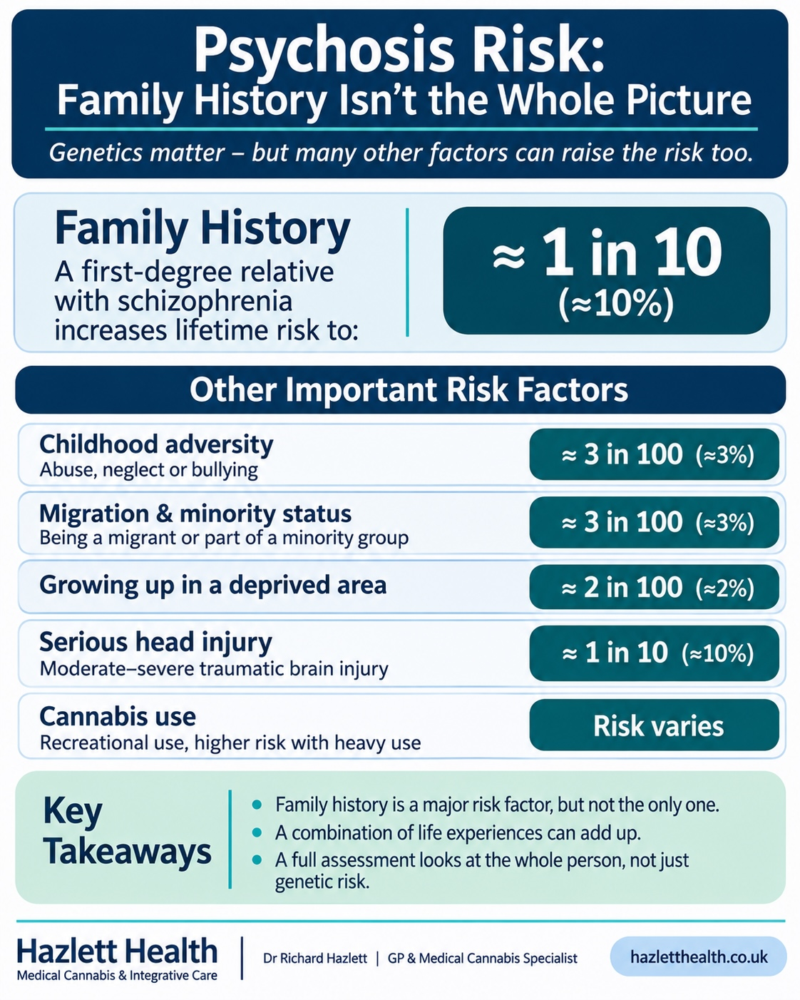

This article is a reflection on my own reading, research and experience of reviewing 10's of thousands of medical cannabis patients. It is not peer reviewed research and should be treated as a reflective blog and nothing more. I welcome comment and discussion including intense criticism of the piece if it is warranted.

A question came up among colleagues recently that I have been turning over for some time. If a patient has a parent, brother or sister who has had schizophrenia, should that alone rule out a cannabis prescription?

Family history is the strongest single predictor of psychosis we have, so the instinct to stop and think is the right one. My worry is narrower. In day to day practice I see family history treated as a single pass or fail test, while other risks of a similar size are never raised at all. I am not involved in the screening process or initial appointments where cannabis treatment is commenced but if I see these during follow up I can raise any issues with the multi disciplinary team. Having spent part of my career in early intervention in psychosis services before moving into cannabis medicine, I have seen the impact environmental factors can play alongside genetic risks.

This piece is for two readers: the patient trying to understand what their own history means, and the clinician deciding whether to prescribe. I want to be clear from the outset that none of it is an argument for taking genetic risk lightly.

<h3>The genetic risk is real</h3>

Most people never develop psychosis. Across the general population the lifetime risk sits at a little under 1 in 100 <a href="https://doi.org/10.1371/journal.pmed.0020141" target="_blank" rel="noopener">[1]</a>. Having a first-degree relative with the condition raises that to somewhere around 1 in 10 <a href="https://pubmed.ncbi.nlm.nih.gov/19150704/" target="_blank" rel="noopener">[2]</a><a href="https://doi.org/10.1001/archpsyc.60.12.1187" target="_blank" rel="noopener">[3]</a>, depending on which relative is affected and how the figure is measured.

It deserves to be taken seriously and assessed properly. A patient with that history should have it discussed openly, recorded, and weighed in any decision about cannabis.

<h3>It is not the only risk that counts</h3>

Here is the part I think we overlook. Several life experiences significantly raise the risk of psychosis close to the levels seen with a family history, yet we rarely ask about them before prescribing.

&bull;&nbsp; A difficult or frightening childhood, including abuse, neglect or being bullied, roughly trebles the risk (3 in 100). It also stacks: one bad experience lifts the risk a little, but several together can push it to around six times the baseline (6 in 100). <a href="https://doi.org/10.1093/schbul/sbs050" target="_blank" rel="noopener">[4]</a>

&bull;&nbsp; Being a migrant, or part of a minority group that faces discrimination, carries about two to three times the risk (3 in 100). That raised risk continues into the second generation of children from migrant parents, which points to the experience of social exclusion rather than the move itself. <a href="https://doi.org/10.1176/appi.ajp.162.1.12" target="_blank" rel="noopener">[5]</a>

&bull;&nbsp; Growing up in a deprived area roughly doubles it (2 in 100). <a href="https://pmc.ncbi.nlm.nih.gov/articles/PMC3494055" target="_blank" rel="noopener">[6]</a>

The one I want to single out is serious head injury, because it sits closest to family history and almost never gets mentioned. In fact, this is often one of the conditions that patients seek cannabis treatment for. The studies put the relative increase from a traumatic brain injury at somewhere between one and a half and three times (1.5 - 3 in 100) <a href="https://pmc.ncbi.nlm.nih.gov/articles/PMC3196949" target="_blank" rel="noopener">[7]</a>. On its own that sounds smaller than the genetic figure. Once studies are stratified between minor head injuries and moderate to severe head injuries the gap narrows.

After a moderate to severe head injury, the reported rate of psychosis climbs towards 1 in 10, which is close to the figure we treat as decisive when it comes from a parent or sibling. This absolute figure comes from older reviews, and it is important to note that it is severity stratified, applying to moderate and severe injuries specifically rather than to head injury in general. <a href="https://neuro.psychiatryonline.org/doi/10.1176/jnp.14.2.130" target="_blank" rel="noopener">[8]</a>

<figure style="margin:1.5rem 0;cursor:pointer;" onclick="openLightbox('psychrisk1')">
  
  <figcaption style="font-size:0.75rem;color:#8a8278;margin-top:0.4rem;text-align:center;">Psychosis risk factors beyond family history (click to enlarge)</figcaption>
</figure>

The relative increase from a head injury is lower than from a first-degree relative, and the highest absolute figures tend to come from the more severe injuries and from hospital-based groups, which can push the number up. Even allowing for that, a serious brain injury is not a minor risk factor, and it is strange that we screen hard for one strong risk while passing over another that is nearly as large.

For completeness, and because it would be dishonest to leave it out, cannabis itself belongs on this list. Recreational use is associated with increased risk <a href="https://doi.org/10.1016/S0140-6736(07)61162-3" target="_blank" rel="noopener">[9]</a>, daily use of high-potency cannabis increases this further <a href="https://pmc.ncbi.nlm.nih.gov/articles/PMC4988731" target="_blank" rel="noopener">[10]</a><a href="https://doi.org/10.1016/S2215-0366(19)30048-3" target="_blank" rel="noopener">[11]</a>. Only in recent years are we acquiring data from medical cannabis patients, including registry data from UK medical cannabis clinics, which point towards reduced risk in the medical cannabis population compared to older studies completed on recreational users <a href="https://pmc.ncbi.nlm.nih.gov/articles/PMC8411316" target="_blank" rel="noopener">[13]</a>.

<h3>Risks add up</h3>

The stress model of psychosis highlights that various environmental factors including drug and alcohol use combine and increase overall risk for an individual <a href="https://doi.org/10.1037/0021-843X.86.2.103" target="_blank" rel="noopener">[12]</a>. The childhood trauma figures show it plainly: the risk rises step by step as the number of adverse childhood experiences are accumulated. Someone who carries several of these histories at once can end up at a higher risk than someone with a single strong factor on its own.

A patient with a family history of psychosis and no other environmental factors may be at lower risk than we assume. However, a patient with no family history of psychosis, but who grew up in a conflict zone, sustained a severe head injury, sought asylum in the UK and is placed in a deprived inner city location, may be at higher risk than anyone has thought to check. If we are serious about psychosis risk, the honest approach is to look at the whole person rather than the easy to document genetic risk.

<h3>Why a prescription can be safer than the street</h3>

There is a point in this debate that often gets lost. The patients we are talking about are usually already using cannabis they have bought on the street. So the realistic question is whether that use carries on with medical oversight or without it.

A prescription changes the risk in several ways.

&bull;&nbsp; Strength is known and controlled. Prescribed products have a stated THC and CBD content, and the balance can be set to favour CBD, which may offset some of the effects of THC. Most street cannabis in the UK is high THC with little or no CBD, the profile most closely linked to psychosis.

&bull;&nbsp; The dose is capped. A prescription fixes the quantity and the daily amount, so the heavy daily high-potency use that carries the most risk can be reined in.

&bull;&nbsp; Prescribed cannabis is regulated and screened for contaminants. Illicit cannabis can be cut with other substances, from synthetic cannabinoids to moulds and pesticides.

&bull;&nbsp; A prescribed patient comes back for review, so any early shift in their mental health can be spotted and acted on. Someone buying on the street has no such safety net.

Withdrawing a prescription from someone who will simply return to the illicit market does not remove the risk. In most cases it makes it worse, and it removes the one setting in which the risk can actually be managed.

<h3>What this means in practice</h3>

None of this is a case for prescribing freely to anyone at high risk, and it is certainly not a case for ignoring family history. The argument is for consistency, thorough assessment of the patient at the outset and for honesty with the patient.

In practice that means taking a proper history of all the risk factors, not just the most obvious one. It means weighing genetic risk fully wherever it is present. It means being frank with the patient about what their particular combination of risks does and does not mean, letting a person with capacity make an informed choice about their own treatment, and, where cannabis is prescribed, favouring a lower-THC or balanced product with clear monitoring and an agreed plan for what to watch for. Many patients will not know what prodromal symptoms of psychosis look like and being aware of the warning signs of changing sleep patterns, increased isolation, increased irritability, mild delusions of reference or paranoia can allow patients the tools to seek help when it is needed.

Taking a full history of someone's risk takes longer than asking one question and stopping, but for a decision that affects a person's quality of life and their safety, it is the only approach that does the evidence justice.

This article is for general information and discussion. It is not medical advice for any individual, and anyone weighing up cannabis treatment should do so with their own prescriber. The figures are drawn from large pooled studies in the psychosis literature.

<h3>References</h3>

1. Saha S, et al. A systematic review of the prevalence of schizophrenia. PLoS Medicine. 2005;2(5):e141.

2. Lichtenstein P, et al. Common genetic determinants of schizophrenia and bipolar disorder in Swedish families: a population-based study. The Lancet. 2009;373(9659):234-239.

3. Sullivan PF, Kendler KS, Neale MC. Schizophrenia as a complex trait: evidence from a meta-analysis of twin studies. Archives of General Psychiatry. 2003;60(12):1187-1192.

4. Varese F, et al. Childhood adversities increase the risk of psychosis: a meta-analysis of patient-control, prospective- and cross-sectional cohort studies. Schizophrenia Bulletin. 2012;38(4):661-671.

5. Cantor-Graae E, Selten JP. Schizophrenia and migration: a meta-analysis and review. American Journal of Psychiatry. 2005;162(1):12-24.

6. Vassos E, et al. Meta-analysis of the association of urbanicity with schizophrenia. Schizophrenia Bulletin. 2012;38(6):1118-1123.

7. Molloy C, Conroy RM, Cotter DR, Cannon M. Is traumatic brain injury a risk factor for schizophrenia? A meta-analysis of case-controlled population-based studies. Schizophrenia Bulletin. 2011;37(6):1104-1110.

8. Davison K, Bagley CR. Schizophrenia-like psychoses associated with organic disorders of the central nervous system: a review of the literature. British Journal of Psychiatry Special Publication No. 4. 1969. And: Fujii D, Ahmed I. Characteristics of psychotic disorder due to traumatic brain injury. Journal of Neuropsychiatry and Clinical Neurosciences. 2002;14(2):130-140.

9. Moore THM, et al. Cannabis use and risk of psychotic or affective mental health outcomes: a systematic review. The Lancet. 2007;370(9584):319-328.

10. Marconi A, Di Forti M, Lewis CM, Murray RM, Vassos E. Meta-analysis of the association between the level of cannabis use and risk of psychosis. Schizophrenia Bulletin. 2016;42(5):1262-1269.

11. Di Forti M, et al. The contribution of cannabis use to variation in the incidence of psychotic disorder across Europe (EU-GEI): a multicentre case-control study. The Lancet Psychiatry. 2019;6(5):427-436.

12. Zubin J, Spring B. Vulnerability: a new view of schizophrenia. Journal of Abnormal Psychology. 1977;86(2):103-126.

13. Erridge S, et al. An initial analysis of the UK Medical Cannabis Registry: outcomes analysis of first 129 patients. Neuropsychopharmacology Reports. 2021;41(3):362-370. And the Project Twenty21 real-world outcomes dataset (Drug Science, 2023).

